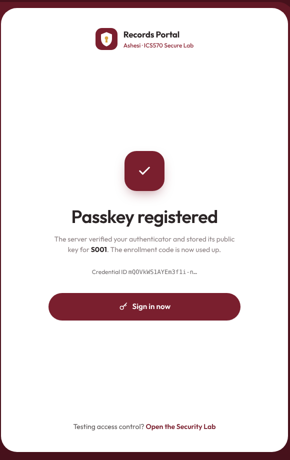
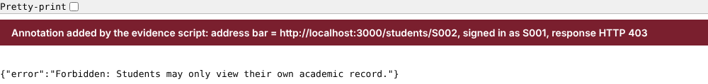
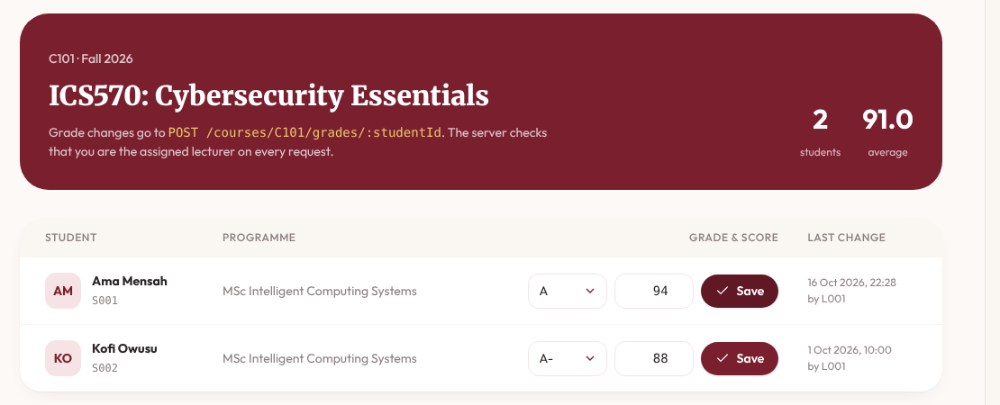
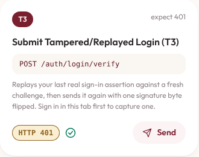
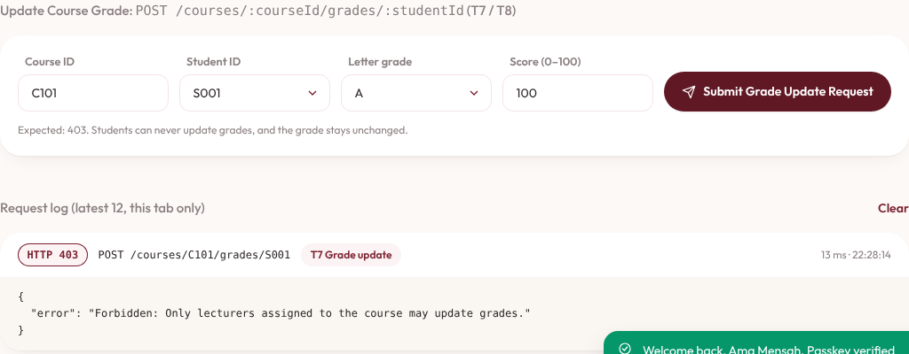

# ICS570 Lab 2: Secure Student Records Portal — Evidence & Security Analysis

**Group 1:** Elise Oyilonye Kennedy-Angbo (G35532028) · Joseph Delali Kodzo Etse (G90412028) · Liza Ekua Ndede Aikins (G01322028) · Eugene Emmanuel Sewor (G25522028)  
**Course:** ICS570 Cybersecurity Essentials, Module 3 · **Origin / RP ID:** `http://localhost:3000` / `localhost` · **Stack:** Node.js, Express, `express-session`, `@simplewebauthn/server`, native browser WebAuthn API

## 1. Security Test Matrix (T1–T8)

Every test passed in two independent runs. The first was the API harness, `npm test` (results in `evidence/test-run-log.json`). The second was a real browser: Chromium driving the UI with a CDP virtual authenticator, the same mechanism as Chrome DevTools → WebAuthn (`scripts/browser-evidence.mjs`, results in `evidence/browser-run-log.json` and `evidence/screenshots/`).

| Test | Identity | Request / action | Expected | Observed (HTTP response / UI) | Result |
|---|---|---|---|---|---|
| T1 | S001 | `POST /auth/register/options` with one-time code, then `/auth/register/verify` | Credential registered to S001; public key stored | **200** `{"verified":true,"userId":"S001"}`. COSE public key saved in `data/db.json`, enrollment code consumed. Credential ID random per run. (Fig. 1) | PASS |
| T2 | S001 | `POST /auth/login/options`, then `/auth/login/verify` | Fresh challenge verified; session created | **200** `{"verified":true,"user":{"id":"S001","role":"student"}}`. Session regenerated; `HttpOnly` `portal.sid` cookie set. | PASS |
| T3 | Attacker → S001 | (a) replay T2 assertion; (b) flip one signature byte | Rejected; no session | (a) **400** "Missing or already-used challenge" (no pending challenge); **401** against a fresh challenge. (b) **401** "Passkey signature verification failed." `/auth/session` → `authenticated:false`. (Fig. 3) | PASS |
| T4 | No session | `GET /students/S001` | Denied (401) | **401** "Authentication required: No valid session." Same after `POST /logout`. | PASS |
| T5 | S001 | `GET /students/S001` | Allowed | **200**: S001 record (C101, B+, 84). | PASS |
| T6 | S001 | `GET /students/S002` by changing the ID (curl and address bar) | Denied (403/404) | **403** "Forbidden: Students may only view their own academic record." (§2.1, Fig. 2) | PASS |
| T7 | S001 | `POST /courses/C101/grades/S001` `{"grade":"A","score":100}` | Denied; grade unchanged | **403** "Forbidden: Only lecturers assigned to the course may update grades." Grade still B+/84. (§2.2, Fig. 3) | PASS |
| T8 | L001 | `POST /courses/C101/grades/S001` `{"grade":"A","score":94}` | Allowed after lecturer/course check | **200** `{"updated":true}`. Grade now A/94, `updatedBy: "L001"`. (Fig. 4) | PASS |

Minimum route policy, also probed directly:

- A lecturer can read only students in their course: L001 → S001 or S002 returns 200; an unknown ID returns 403.
- `POST /logout` destroys the session; later protected requests return 401.
- An unauthenticated visitor reaches only the login/registration page. Every protected route returns 401.

## 2. Direct Requests the UI Did Not Offer

**2.1 T6: S001 edits the ID in the URL (curl, S001 session cookie)**
```http
$ curl -i http://localhost:3000/students/S002 -H "Cookie: portal.sid=<S001-session>"
HTTP/1.1 403 Forbidden
{"error":"Forbidden: Students may only view their own academic record."}
```
**2.2 T7: S001 calls the lecturer grade endpoint directly, bypassing the UI**
```http
$ curl -i -X POST http://localhost:3000/courses/C101/grades/S001 -H "Content-Type: application/json" \
       -H "Cookie: portal.sid=<S001-session>" -d '{"grade":"A","score":100}'
HTTP/1.1 403 Forbidden
{"error":"Forbidden: Only lecturers assigned to the course may update grades."}
```
**2.3 Policy checks responsible (`src/middleware/authz.js`).** Both run as Express middleware after `requireAuth`, which returns 401 for T4, and before any data is read or written:
```javascript
// authorizeStudentRecordRead: GET /students/:studentId (T5, T6)
if (actor.role === 'student' && actor.id !== targetStudentId)
  return res.status(403).json({ error: 'Forbidden: Students may only view their own academic record.' });
// authorizeGradeUpdate: POST /courses/:courseId/grades/:studentId (T7, T8)
if (actor.role !== 'lecturer')
  return res.status(403).json({ error: 'Forbidden: Only lecturers assigned to the course may update grades.' });
if (course.lecturerId !== actor.id)   // after a 404 check for an unknown course
  return res.status(403).json({ error: `Forbidden: Lecturer ${actor.id} is not assigned to course ${courseId}.` });
```
**2.4 Server audit log (`npm test` stdout, abridged).** No cookies, challenges or keys are logged; challenge values in error reasons are masked:
```text
[AUDIT] {"event":"LOGIN_VERIFY_DENIED","reason":"Missing or already-consumed authentication challenge (possible replay)"}
[AUDIT] {"event":"AUTHN_DENIED","method":"GET","path":"/students/S001","reason":"Missing or invalidated session"}
[AUDIT] {"event":"AUTHZ_DENIED","actorId":"S001","action":"READ_STUDENT_RECORD","targetStudentId":"S002","reason":"Student attempted to access another student record (ownership violation)"}
[AUDIT] {"event":"AUTHZ_DENIED","actorId":"S001","action":"UPDATE_COURSE_GRADE","courseId":"C101","targetStudentId":"S001","reason":"Non-lecturer attempted to invoke grade-update endpoint"}
[AUDIT] {"event":"GRADE_UPDATED","actorId":"L001","courseId":"C101","studentId":"S001","newGrade":"A","newScore":94}
```

<table class="figs">
<tr>
<td style="width:34%" rowspan="2"><b>Fig. 1 (T1).</b> S001 registers a passkey in the browser; the server verifies it and stores the public key.</td>
<td><b>Fig. 2 (T6).</b> Signed in as S001, <code>/students/S002</code> typed into the address bar returns 403.</td>
</tr>
<tr>
<td><b>Fig. 4 (T8).</b> L001 saves S001's C101 grade (A / 94).</td>
</tr>
<tr>
<td colspan="2"><table class="figs"><tr>
<td style="width:30%"></td>
<td></td>
</tr></table><b>Fig. 3 (T3, T7).</b> Security Lab as S001. Left: the replayed, then tampered, sign-in returns 401 and no new session is created. Right: the direct grade update returns 403, and the grade is unchanged.</td>
</tr>
</table>

## 3. Security Interpretation

**A. Authentication vs. Authorization**  
Passing T2 proves authentication: the server verified a fresh challenge signed by `S001`'s registered private key and bound `req.session.user` to `{ id: "S001", role: "student" }`. However, authentication only answers *who* the caller is, not *what* resources or actions they are permitted to access. Allowing T6 or T7 merely because T2 succeeded would collapse authorization into authentication, enabling any authenticated student to read peers' transcripts (horizontal privilege escalation) or overwrite course grades (vertical privilege escalation). Our server enforces this boundary on every request in `src/middleware/authz.js`: `authorizeStudentRecordRead` checks `actor.id === req.params.studentId` for students (returning HTTP 403 in T6), while `authorizeGradeUpdate` checks `actor.role === "lecturer"` and `course.lecturerId === actor.id` before any database write occurs (returning HTTP 403 in T7 and leaving `S001`'s grade unchanged at `B+`).

**B. Residual Weakness and Proportionate Mitigation**  
A realistic residual weakness in our implementation is initial passkey enrollment and account recovery via static enrollment codes (`enrollmentCode` in `data/seed.json`). If an attacker intercepts an unused enrollment code or compromises a help-desk re-enrollment workflow, they can bind their own authenticator to the victim's account before the legitimate user enrolls. A proportionate fix is replacing static codes with short-lived (e.g., 10-minute TTL), cryptographically random one-time enrollment tokens tied to out-of-band identity verification, coupled with immediate notification and mandatory re-verification of existing sessions whenever a new passkey is added.

**C. Transfer to SLS ProSit 2**  
This directly mirrors the core flaw in SLS ProSit 2 (Stage 1), where Management proposes placing all company systems behind one Single Sign-On login with MFA and assuming the access problem is solved. As Amy Windahl rightly objects, strong login only proves *who* signed in—just as T2 authenticated `S001`—without governing what that identity may do afterward. In SLS, an employee who transferred from Finance to Procurement six weeks ago still retains permission to modify supplier-payment records, and the order-processing service account holds unexplained access to a Finance folder. Even if SLS upgrades every user to phishing-resistant passkeys, those excessive privileges remain exploitable unless SLS enforces least-privilege, role- and resource-scoped authorization checks (like our T6/T7 middleware) and revokes stale role assignments immediately upon job transfer.

_Full screenshots for every test: `evidence/screenshots/`. Part B (AES-GCM) is submitted separately: `PART_B_ADDENDUM.md`._
