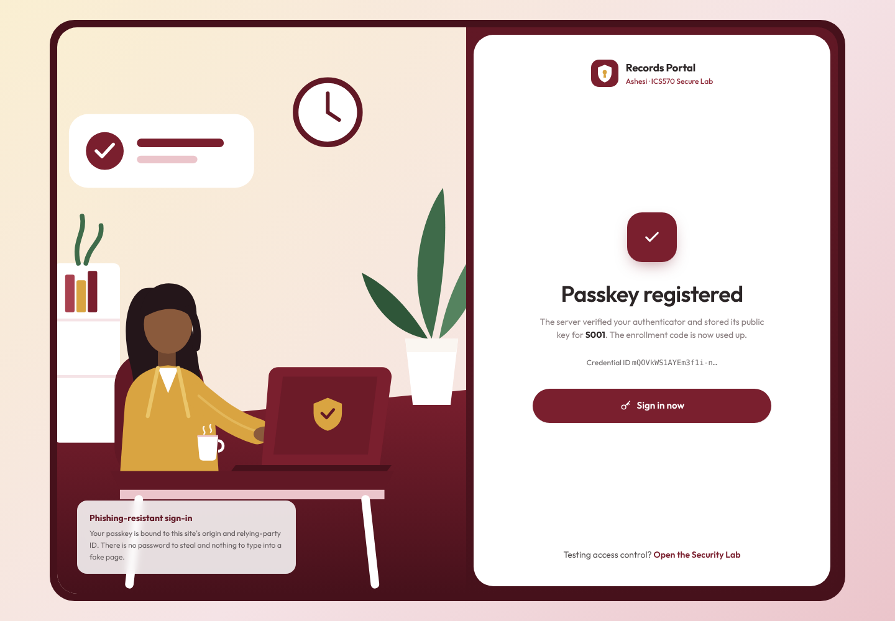
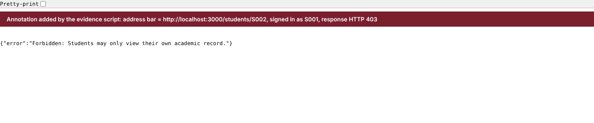
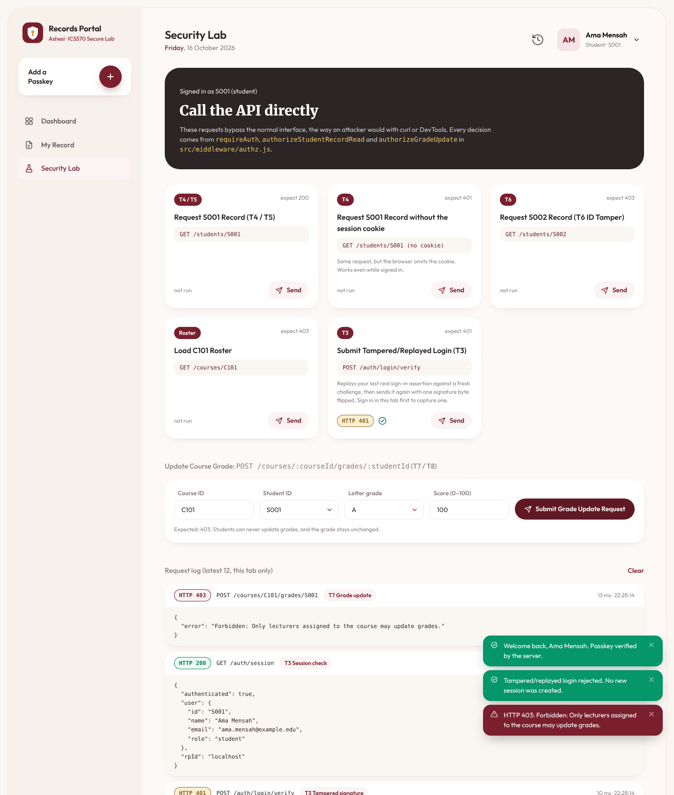
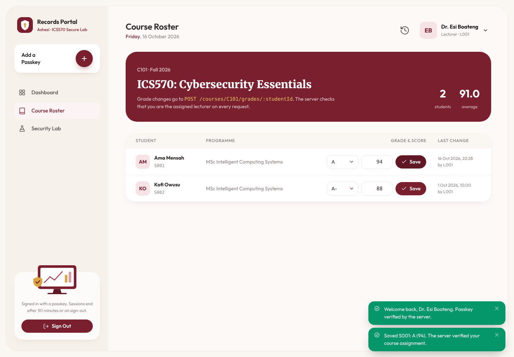
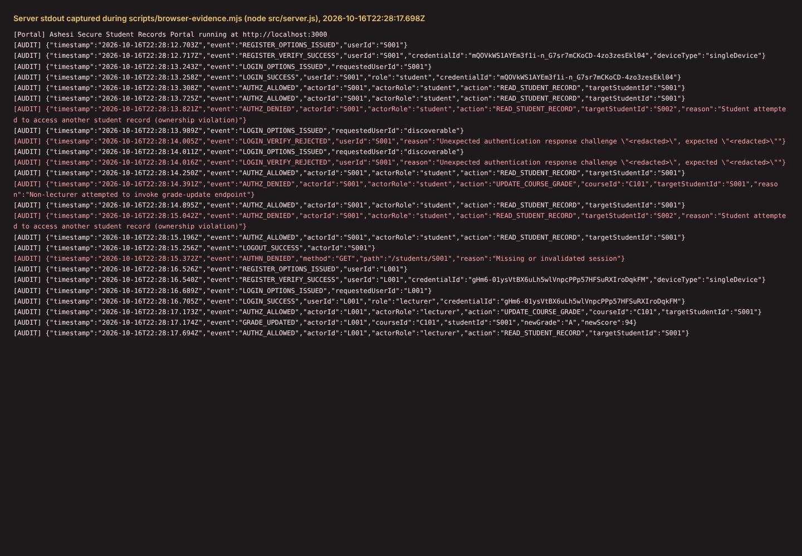

# ICS570 Lab 2: Secure Student Records Portal — Evidence & Security Analysis Report

**Group 1 members:**

| Student ID | Name |
|---|---|
| G35532028 | Elise Oyilonye Kennedy-Angbo |
| G90412028 | Joseph Delali Kodzo Etse |
| G01322028 | Liza Ekua Ndede Aikins |
| G25522028 | Eugene Emmanuel Sewor |

**Course:** ICS570: Cybersecurity Essentials (Module 3: Identity and Access Control)  
**Application Origin / RP ID:** `http://localhost:3000` (`rpId: "localhost"`)  
**Stack:** Node.js, Express, `express-session`, `@simplewebauthn/server`, native browser WebAuthn API (static HTML/CSS/ES-module UI)

---

## 1. Security Test Matrix Results (T1–T8)

Each test was run two ways and passed both times:
- **API harness:** `npm test` writes `evidence/test-run-log.json`, last run 2026-10-16T22:28Z.
- **Real browser:** Chromium driving the portal UI with a CDP virtual authenticator, the same mechanism as Chrome DevTools → WebAuthn. `scripts/browser-evidence.mjs` writes `evidence/browser-run-log.json`, `evidence/browser-run-audit.log` and `evidence/screenshots/`.

| Test | Identity / Condition | Request / Action | Expected Outcome | Observed Outcome & HTTP Status | Result |
|---|---|---|---|---|---|
| **T1** | `S001` (Student, Ama Mensah) | `POST /auth/register/options` (one-time code `ENROLL-S001-8492`) + `POST /auth/register/verify` | Credential registered to `S001`; COSE public key stored server-side | `HTTP 200` — `{ "verified": true, "userId": "S001", "credentialId": "…" }`. The credential ID is random per run (latest: `9nzLvgSX…`; browser run: `p0ZMEoRm…`). Public key persisted in `data/db.json`; enrollment code marked consumed. Fig. 1. | **PASS** |
| **T2** | `S001` (Student) | `POST /auth/login/options` + `POST /auth/login/verify` | Fresh signed challenge verified; authenticated session created | `HTTP 200` — `{ "verified": true, "user": { "id": "S001", "role": "student" } }`. Session regenerated; `portal.sid` `HttpOnly` cookie issued. | **PASS** |
| **T3** | Unauthenticated attacker targeting `S001` | **(a)** Replay `T2` assertion to `POST /auth/login/verify`<br>**(b)** Submit altered signature bytes | Server rejects invalid proof or replayed challenge; no session created | **(a) Replay, no pending challenge:** `HTTP 400` (`"Authentication rejected: Missing or already-used challenge."`); **replay against a fresh challenge** (browser): `HTTP 401`<br>**(b) Tampered signature:** `HTTP 401` (`"Passkey signature verification failed."`)<br>`GET /auth/session` → `{ "authenticated": false }` (harness); browser session stays `S001`, no new session. | **PASS** |
| **T4** | Unauthenticated visitor (no session cookie) | `GET /students/S001` | Denied (`HTTP 401`) | `HTTP 401` — `{ "error": "Authentication required: No valid session." }` (also after `POST /logout`). | **PASS** |
| **T5** | `S001` (Authenticated Student) | `GET /students/S001` | Allowed (`HTTP 200`) | `HTTP 200` — `S001` record (`C101`, `B+`, `84`). | **PASS** |
| **T6** | `S001` editing URL/ID | Direct `GET /students/S002` with `S001` session (curl and address bar) | Denied (`HTTP 403`) | `HTTP 403` — `{ "error": "Forbidden: Students may only view their own academic record." }`. Fig. 2. | **PASS** |
| **T7** | `S001` calling lecturer endpoint directly | `POST /courses/C101/grades/S001` `{"grade":"A","score":100}` | Denied (`HTTP 403`); grade unchanged | `HTTP 403` — `{ "error": "Forbidden: Only lecturers assigned to the course may update grades." }`; grade still `B+` (`84`). Fig. 3. | **PASS** |
| **T8** | `L001` (Lecturer assigned to `C101`) | `POST /courses/C101/grades/S001` `{"grade":"A","score":94}` | Allowed (`HTTP 200`) after lecturer/course check | `HTTP 200` — `{ "updated": true }`; `S001` `C101` grade now `A` (`94`), `updatedBy: "L001"`. Fig. 4. | **PASS** |

---

## 2. Direct Non-UI Request Evidence

### 2.1 Direct `curl` Probe for T6 (Horizontal Privilege Escalation Attempt)
While authenticated as `S001`, the student bypasses the UI and requests `S002`'s record directly by editing the URL path:

```http
$ curl -i -s -X GET http://localhost:3000/students/S002 -H "Cookie: portal.sid=<S001-session>"

HTTP/1.1 403 Forbidden
X-Powered-By: Express
Content-Type: application/json; charset=utf-8
Content-Length: 72
Date: Fri, 16 Oct 2026 18:48:15 GMT

{"error":"Forbidden: Students may only view their own academic record."}
```

### 2.2 Direct `curl` Probe for T7 (Vertical Privilege Escalation Attempt)
While authenticated as `S001`, the student self-assigns an `A` (`100`) with a direct `curl` request that bypasses the UI entirely. (The Security Lab page also offers this form to every role, for testing; the evidence below does not depend on any UI.)

```http
$ curl -i -s -X POST http://localhost:3000/courses/C101/grades/S001 \
  -H "Content-Type: application/json" \
  -H "Cookie: portal.sid=<S001-session>" \
  -d '{"grade":"A","score":100}'

HTTP/1.1 403 Forbidden
X-Powered-By: Express
Content-Type: application/json; charset=utf-8
Content-Length: 79
Date: Fri, 16 Oct 2026 18:48:15 GMT

{"error":"Forbidden: Only lecturers assigned to the course may update grades."}
```

### 2.3 Server-Side Audit Trail (`stdout` from `npm test`, timestamps trimmed)
Session cookies, challenges and private keys are never written to the log:
```json
[AUDIT] {"event":"REGISTER_VERIFY_SUCCESS","userId":"S001","credentialId":"9nzLvgSX…","deviceType":"multiDevice"}
[AUDIT] {"event":"LOGIN_SUCCESS","userId":"S001","role":"student","credentialId":"9nzLvgSX…"}
[AUDIT] {"event":"LOGIN_VERIFY_DENIED","reason":"Missing or already-consumed authentication challenge (possible replay)"}
[AUDIT] {"event":"LOGIN_VERIFY_FAILED","userId":"S001"}
[AUDIT] {"event":"AUTHN_DENIED","method":"GET","path":"/students/S001","reason":"Missing or invalidated session"}
[AUDIT] {"event":"AUTHZ_DENIED","actorId":"S001","actorRole":"student","action":"READ_STUDENT_RECORD","targetStudentId":"S002","reason":"Student attempted to access another student record (ownership violation)"}
[AUDIT] {"event":"AUTHZ_DENIED","actorId":"S001","actorRole":"student","action":"UPDATE_COURSE_GRADE","courseId":"C101","targetStudentId":"S001","reason":"Non-lecturer attempted to invoke grade-update endpoint"}
[AUDIT] {"event":"AUTHZ_ALLOWED","actorId":"L001","actorRole":"lecturer","action":"UPDATE_COURSE_GRADE","courseId":"C101","targetStudentId":"S001"}
[AUDIT] {"event":"GRADE_UPDATED","actorId":"L001","courseId":"C101","studentId":"S001","newGrade":"A","newScore":94}
```
In the browser run (Figure 5) a replayed assertion is logged as `LOGIN_VERIFY_REJECTED` with `reason: "Unexpected authentication response challenge \"<redacted>\", expected \"<redacted>\""`. The server masks challenge values before logging, and the client receives only the generic `"Passkey signature verification failed."`.

### 2.4 Policy Checks Responsible for T6 and T7 (`src/middleware/authz.js`)
```javascript
// authorizeStudentRecordRead — GET /students/:studentId (T5, T6)
if (actor.role === 'student' && actor.id !== targetStudentId) {
  return res.status(403).json({ error: 'Forbidden: Students may only view their own academic record.' });
}
// authorizeGradeUpdate — POST /courses/:courseId/grades/:studentId (T7, T8)
if (actor.role !== 'lecturer') {
  return res.status(403).json({ error: 'Forbidden: Only lecturers assigned to the course may update grades.' });
}
```
Both run as Express middleware after `requireAuth` (which returns `401`, T4) and before any database read or write.

---

## 3. Browser Evidence (selected screenshots)

<table>
<tr>
<td width="50%"><br><b>Fig. 1 — T1.</b> S001 registers a passkey via <code>navigator.credentials.create</code>; the server verifies it and stores the public key.</td>
<td width="50%"><br><b>Fig. 2 — T6.</b> Signed in as S001, <code>/students/S002</code> typed straight into the address bar → <code>HTTP 403</code>.</td>
</tr>
<tr>
<td><br><b>Fig. 3 — T3 &amp; T7.</b> Security Lab as S001: the replayed and tampered sign-in both get <code>401</code>, and the direct grade update gets <code>403</code>.</td>
<td><br><b>Fig. 4 — T8.</b> L001 saves S001's C101 grade (A / 94); the server verified the course assignment.</td>
</tr>
<tr>
<td colspan="2"><br><b>Fig. 5 — Server <code>[AUDIT]</code> output</b> captured during the browser run (<code>evidence/browser-run-audit.log</code>), showing <code>AUTHZ_DENIED</code> for T6/T7 and <code>LOGIN_VERIFY_REJECTED</code> for T3.</td>
</tr>
</table>

Screenshots for every test are in `evidence/screenshots/` (`T1-register.png` … `T8-lecturer-grade-update.png`).

---

## 4. Security Interpretation (336 Words Total)

**A. Authentication vs. Authorization (124 words)**  
Passing T2 proves authentication: the server verified a fresh challenge signed by `S001`'s registered private key and bound `req.session.user` to `{ id: "S001", role: "student" }`. However, authentication only answers *who* the caller is, not *what* resources or actions they are permitted to access. Allowing T6 or T7 merely because T2 succeeded would collapse authorization into authentication, enabling any authenticated student to read peers' transcripts (horizontal privilege escalation) or overwrite course grades (vertical privilege escalation). Our server enforces this boundary on every request in `src/middleware/authz.js`: `authorizeStudentRecordRead` checks `actor.id === req.params.studentId` for students (returning HTTP 403 in T6), while `authorizeGradeUpdate` checks `actor.role === "lecturer"` and `course.lecturerId === actor.id` before any database write occurs (returning HTTP 403 in T7 and leaving `S001`'s grade unchanged at `B+`).

**B. Residual Weakness and Proportionate Mitigation (88 words)**  
A realistic residual weakness in our implementation is initial passkey enrollment and account recovery via static enrollment codes (`enrollmentCode` in `data/seed.json`). If an attacker intercepts an unused enrollment code or compromises a help-desk re-enrollment workflow, they can bind their own authenticator to the victim's account before the legitimate user enrolls. A proportionate fix is replacing static codes with short-lived (e.g., 10-minute TTL), cryptographically random one-time enrollment tokens tied to out-of-band identity verification, coupled with immediate notification and mandatory re-verification of existing sessions whenever a new passkey is added.

**C. Transfer to SLS ProSit 2 (124 words)**  
This directly mirrors the core flaw in SLS ProSit 2 (Stage 1), where Management proposes placing all company systems behind one Single Sign-On login with MFA and assuming the access problem is solved. As Amy Windahl rightly objects, strong login only proves *who* signed in—just as T2 authenticated `S001`—without governing what that identity may do afterward. In SLS, an employee who transferred from Finance to Procurement six weeks ago still retains permission to modify supplier-payment records, and the order-processing service account holds unexplained access to a Finance folder. Even if SLS upgrades every user to phishing-resistant passkeys, those excessive privileges remain exploitable unless SLS enforces least-privilege, role- and resource-scoped authorization checks (like our T6/T7 middleware) and revokes stale role assignments immediately upon job transfer.

---

_Part B (AES-GCM) is submitted separately as an addendum: see [`PART_B_ADDENDUM.md`](PART_B_ADDENDUM.md)._
