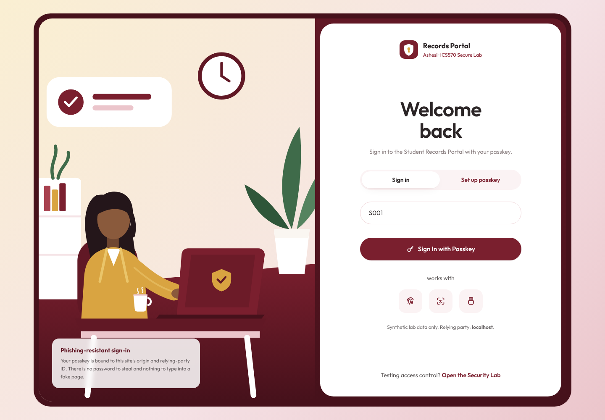
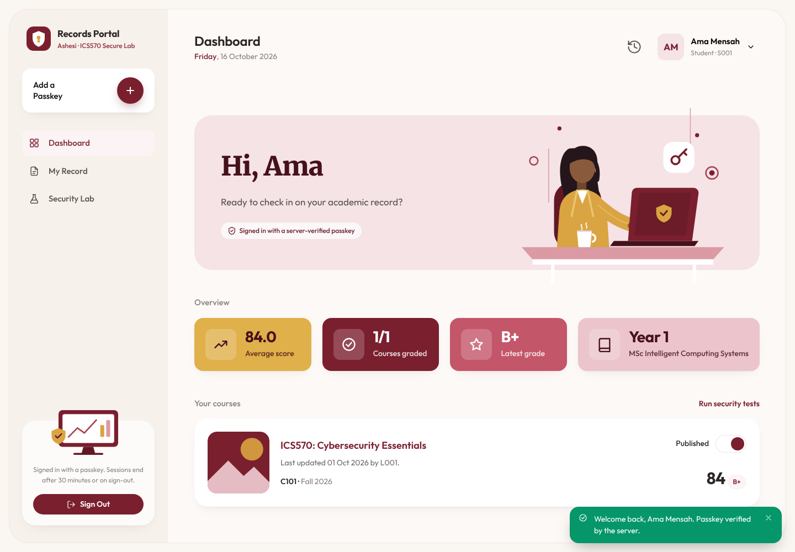
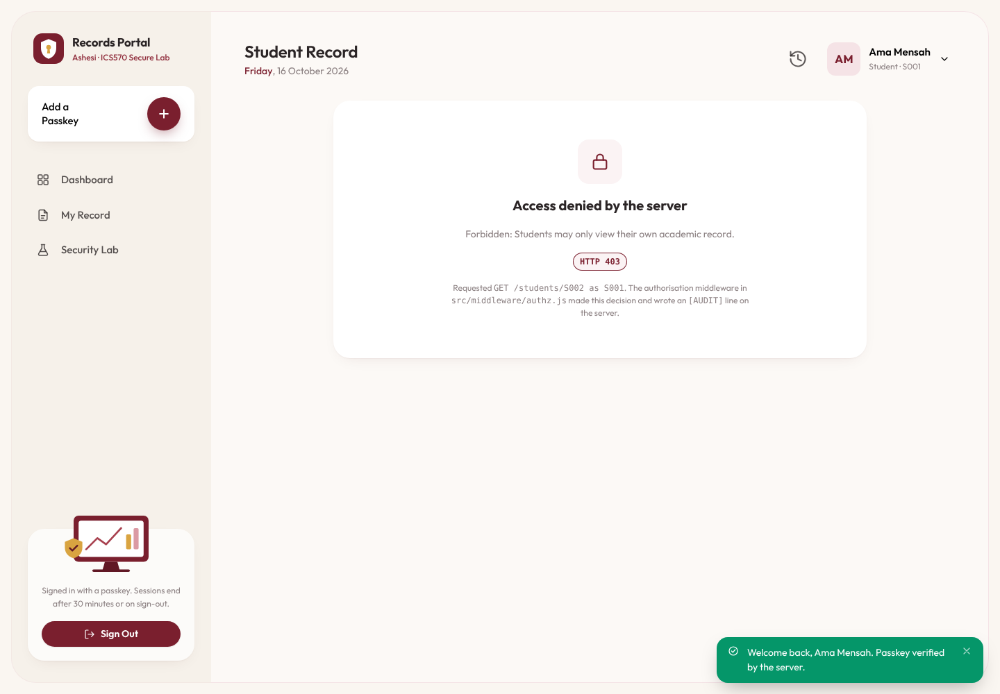
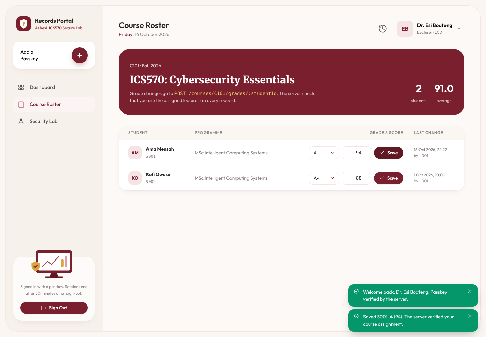

# Ashesi Secure Student Records Portal (ICS570 Lab 2)

A simplified university records portal demonstrating **FIDO2/WebAuthn passkey authentication**, **independent per-request server-side RBAC and record-ownership authorization**, and **AES-256-GCM authenticated encryption** (Part B).

**Group 1 (ICS570):** Elise Oyilonye Kennedy-Angbo (G35532028); Joseph Delali Kodzo Etse (G90412028); Liza Ekua Ndede Aikins (G01322028); Eugene Emmanuel Sewor (G25522028).

## 1. Technology Stack & Prerequisites
- **Runtime:** Node.js `v20+` (tested on Node `v26.11.1`) and `npm`
- **Backend:** Express (`express`), `express-session` (`httpOnly`, `sameSite=lax`), `@simplewebauthn/server`
- **Frontend:** No build step. Static HTML/CSS + ES modules in `public/` (sign-in/enrollment, dashboard, record, course roster, Security Lab). Native Browser WebAuthn API (`navigator.credentials.create` / `get`, `PublicKeyCredential.parseCreationOptionsFromJSON` / `parseRequestOptionsFromJSON`, `webauthn-polyfills`)
- **Datastore:** Canonical synthetic seed in `data/seed.json`, copied at runtime to `data/db.json`

<table>
<tr>
<td width="50%"><br><sub>Passkey sign-in (T2)</sub></td>
<td width="50%"><br><sub>Student dashboard after sign-in</sub></td>
</tr>
<tr>
<td><br><sub>S001 opens S002's record → server 403 (T6)</sub></td>
<td><br><sub>L001 updates a C101 grade (T8)</sub></td>
</tr>
</table>

Per-test evidence screenshots: [`evidence/screenshots/`](evidence/screenshots/) · evidence report: [`EVIDENCE_REPORT.md`](EVIDENCE_REPORT.md) · Part B: [`PART_B_ADDENDUM.md`](PART_B_ADDENDUM.md)

## 2. Installation & Run Commands
```bash
# 1. Install dependencies from lockfile
npm install

# 2. Reset runtime datastore (data/db.json) to initial synthetic seed (data/seed.json)
npm run reset

# 3. Start the portal server at http://localhost:3000
npm start

# 4. Run automated end-to-end T1–T8 security test suite (includes direct curl probes)
npm test

# 5. Run Part B AES-256-GCM encryption & tamper-detection demo
npm run demo:crypto

# 6. (Optional) Real-browser T1–T8 run + screenshots (Chromium virtual authenticator)
npm install --no-save playwright && npx playwright install chromium
node scripts/browser-evidence.mjs
```

## 3. Browser / Authenticator Setup
WebAuthn requires a secure context (`http://localhost:3000`). You may use either:
1. **Platform Authenticator:** macOS Touch ID / iCloud Keychain, Windows Hello, or a password manager passkey extension.
2. **Chrome DevTools Virtual Authenticator (recommended for isolated lab testing):**
   - Open `http://localhost:3000` in Chrome -> Open DevTools (`Cmd+Option+I` / `F12`) -> More Tools -> **WebAuthn**.
   - Check **"Enable virtual authenticator environment"** -> Protocol: `ctap2`, Transport: `internal`, check **Supports resident keys** and **Supports user verification** -> Click **Add**.

## 4. Seeded Test Accounts (`data/seed.json`)
| Account ID | Full Name | Role | Assigned / Enrolled Course | One-Time Initial Enrollment Code |
|---|---|---|---|---|
| `S001` | Ama Mensah | `student` | Enrolled in `C101` (Initial grade: `B+` / `84`) | `ENROLL-S001-8492` |
| `S002` | Kofi Owusu | `student` | Enrolled in `C101` (Initial grade: `A-` / `88`) | `ENROLL-S002-3174` |
| `L001` | Dr. Esi Boateng | `lecturer` | Assigned Lecturer for `C101` | `ENROLL-L001-6059` |

## 5. Steps to Repeat Security Tests (T1–T8)
You can execute all 8 tests automatically via `npm test` (outputs to `evidence/test-run-log.json`) or interactively at `http://localhost:3000`. The probe buttons for T3–T7 are on the **Security Lab** page (`#/lab`), which also opens while signed out:
- **T1 (Passkey Registration):** On the **Set up passkey** tab, select `S001`, enter one-time code `ENROLL-S001-8492`, and click **Register Passkey**. Server verifies attestation and stores the credential ID and COSE public key (`HTTP 200`).
- **T2 (Passkey Sign-In):** On the **Sign in** tab, enter `S001` and click **Sign In with Passkey** (or pick the passkey from the ID field's autofill). Server issues a fresh challenge, verifies the signed assertion, origin, and RP ID (`localhost`), and regenerates the session (`HTTP 200`).
- **T3 (Tampered / Replayed Login):** After signing in, click **Submit Tampered/Replayed Login (T3)**. It replays your real sign-in assertion against a fresh challenge, then resends it with one signature byte flipped (or replay a captured `/auth/login/verify` payload). Server consumes challenges on first use and rejects invalid signatures (`HTTP 400`/`401`, no session created).
- **T4 (Unauthenticated Access):** Click **Sign Out** (`POST /logout`), then **Request S001 Record (T4 / T5)**; or use **Request S001 Record without the session cookie**; or run `curl -i http://localhost:3000/students/S001` without a session cookie. Server returns `HTTP 401 Unauthorized`.
- **T5 (Own Record Read):** While signed in as `S001`, open **My Record** or click **Request S001 Record (T4 / T5)** (`GET /students/S001`). Server verifies `actor.id === 'S001'` and returns `S001`'s record (`HTTP 200`).
- **T6 (Horizontal Privilege Escalation via URL/ID):** While signed in as `S001`, change the address to `#/students/S002`, click **Request S002 Record (T6 ID Tamper)**, or run `curl -i http://localhost:3000/students/S002 -H "Cookie: portal.sid=<S001-cookie>"`. Server denies with `HTTP 403 Forbidden`.
- **T7 (Vertical Privilege Escalation — Direct Grade Endpoint Call):** While signed in as `S001`, submit the Security Lab grade form (**Submit Grade Update Request**) or run `curl -i -X POST http://localhost:3000/courses/C101/grades/S001 -H "Content-Type: application/json" -H "Cookie: portal.sid=<S001-cookie>" -d '{"grade":"A","score":100}'`. Server returns `HTTP 403 Forbidden`; `S001`'s grade remains `B+`.
- **T8 (Authorized Lecturer Grade Update):** Register and sign in as `L001` (`ENROLL-L001-6059`), open **Course Roster**, set S001 to `A` / `94` and click **Save** (this sends `POST /courses/C101/grades/S001` with `{"grade":"A","score":94}`). Server verifies `L001` is assigned to `C101` and updates the grade (`HTTP 200`).
